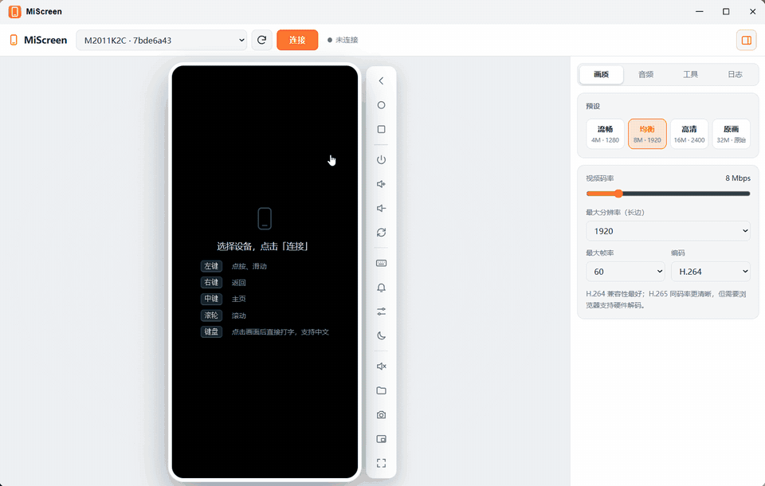

# MiScreen

在浏览器里实时控制 Android 设备（类似 [scrcpy](https://github.com/Genymobile/scrcpy) 的体验），支持音视频传输，画质、码率、帧率、音频编码都可以在页面上调整。



> 演示：连接设备 → 解锁滑动 → 小窗模式 → 文件管理（960px / 12fps，约 30 秒）

## 原理

```
 浏览器                         服务端（Docker）                    手机
┌──────────────┐  WebSocket  ┌───────────────────┐  adb forward  ┌──────────────────┐
│ WebCodecs 解码│◄───视频/音频─┤ Node.js           │◄──────────────┤ scrcpy-server    │
│ Canvas 渲染   │             │  · adb push/shell │   (USB/TCP)   │  MediaCodec 编码  │
│ AudioWorklet  │───控制消息──►│  · 解析 scrcpy 流 │──────────────►│  注入触摸/按键    │
└──────────────┘             └───────────────────┘               └──────────────────┘
```

1. 服务端通过 `adb push` 把官方 `scrcpy-server`（v5.0.1，`vendor/` 目录）推到手机，用 `app_process` 启动。
2. 用 `adb forward` 建立隧道，依次连接 video / audio / control 三个 socket（与 scrcpy 客户端的 `tunnel_forward` 模式相同）。
3. 服务端解析 scrcpy 的帧头（session / config / keyframe 标志、PTS），通过 WebSocket 原样转发 H.264/H.265 与 Opus/AAC/PCM 数据。
4. 浏览器用 **WebCodecs**（`VideoDecoder` / `AudioDecoder`）硬件解码：视频只保留最新一帧绘制，音频经 AudioWorklet 抖动缓冲播放，延迟可调。
5. 鼠标、触摸、滚轮、键盘事件在前端序列化成 scrcpy 控制消息，经 WebSocket 原样写入 control socket。

网络拥塞时，服务端会丢弃视频帧，并发送 `RESET_VIDEO` 让设备立即输出关键帧，延迟不会越积越大。

## 功能

- 实时画面：H.264 / H.265，可调码率（1–40 Mbps）、最大分辨率、最大帧率
- 声音：Opus / AAC / 无压缩 PCM，可调码率、缓冲时长、音量；音频源可选系统输出、应用播放（手机同时出声）、麦克风
- 控制：点按/滑动/多点触控，右键返回，中键主页，滚轮滚动
- 键盘：点击画面后直接打字；中文等非 ASCII 字符通过剪贴板粘贴注入；`Ctrl+V` 把电脑剪贴板粘贴到手机
- 剪贴板双向同步、截图、全屏、旋转、通知栏、关闭手机屏幕但继续投屏
- 文件管理：浏览手机存储，预览图片/视频/音频/文本，下载（文件夹打包为 tar）、上传、重命名、删除；把文件拖到手机画面上会传到 `Download`
- 小窗模式：画面放到置顶的独立窗口（Chrome / Edge 116+）
- 多设备选择、`adb connect` 无线调试

## Docker 部署

在**插着手机的那台 Linux 主机**上运行：

```bash
docker compose up -d --build
# 国内网络：
docker compose build --build-arg NPM_REGISTRY=https://registry.npmmirror.com --build-arg APT_MIRROR=mirrors.ustc.edu.cn
```

或者手动运行：

```bash
docker build -t miscreen .
docker run -d --name miscreen --restart unless-stopped \
  -p 8080:8080 -p 8443:8443 \
  -v /dev/bus/usb:/dev/bus/usb --device-cgroup-rule='c 189:* rmw' \
  -v $PWD/data:/data \
  miscreen
```

然后访问 `https://<主机IP>:8443`。

注意事项：

- **必须用 HTTPS（或 localhost）访问**。浏览器只在安全上下文中提供 WebCodecs。默认会自动生成自签名证书，第一次访问时需要手动信任。也可以用 `TLS_CERT` / `TLS_KEY` 指定正式证书，或者放在反向代理后面（代理需要支持 WebSocket 的 `/ws` 路径）。
- **宿主机上不要运行 adb server**。USB 设备同一时间只能被一个 adb server 占用。
- 第一次连接时，手机上会弹出「允许 USB 调试」，请勾选「始终允许」。adb 密钥保存在 `/data/.android`，挂载卷后重建容器也不需要重新授权。
- 这个页面可以完全控制手机。在非可信网络中，请设置 `AUTH_USER` / `AUTH_PASSWORD` 开启 Basic 认证。

### 环境变量

| 变量 | 默认值 | 说明 |
|---|---|---|
| `PORT` | `8080` | HTTP 端口 |
| `HTTPS_PORT` | `8443` | HTTPS 端口，`0` 表示关闭 |
| `TLS_CERT` / `TLS_KEY` | 空 | 证书路径；为空时自动生成自签名证书 |
| `AUTH_USER` / `AUTH_PASSWORD` | 空 | 设置后启用 HTTP Basic 认证 |
| `DATA_DIR` | `/data` | 数据目录（证书、adb 密钥） |
| `ADB_PATH` | `adb` | adb 可执行文件 |
| `MAX_WS_BUFFER` | `4194304` | WebSocket 发送缓冲上限（字节），超过后丢帧并请求关键帧 |

## 飞牛 fnOS 应用（fpk）

`fnos/` 目录是飞牛应用包的源文件。在飞牛本机（自带 `fnpack`）上运行：

```bash
sudo ./fnos/build.sh        # 生成 fnos/out/miscreen.fpk
```

脚本会先构建 Docker 镜像，把镜像文件系统导出为 `rootfs.tar.gz` 放进安装包。安装时应用中心用包里的 `Dockerfile`（`FROM scratch` + `ADD`）离线构建镜像，不需要联网。

- 安装：应用中心 →「手动安装」选择 fpk，或 `sudo appcenter-cli install-fpk miscreen.fpk`
- 访问：飞牛桌面图标会在飞牛的窗口里打开（经飞牛网关 `/app/miscreen/`，需要登录飞牛）。**飞牛必须用 HTTPS 打开**（如 `https://<飞牛地址>:5667`），否则浏览器在 HTTP 页面里禁用视频解码。也可以直接访问 `https://<飞牛地址>:18443`（自签名证书，首次需手动信任）
- 数据：adb 授权密钥和证书在 `/var/apps/miscreen/shares/miscreen/data`，卸载后保留
- 容器名同为 `miscreen`、端口 18080/18443，不要和上面的 docker compose 部署同时运行
- 升级：改 `fnos/pkg/manifest` 里的 `version` 后重新打包安装

## 本地开发

需要 Node.js 20+，并且本机 `adb devices` 能看到设备。

```bash
npm install
npm run dev:server   # 后端 http://localhost:8080
npm run dev:web      # 前端 http://localhost:5173（代理 /api、/ws 到后端）
```

## 目录结构

```
server/            Node.js 服务端
  index.js         HTTP/HTTPS、WebSocket、静态文件、API
  scrcpy.js        scrcpy-server 会话：推送、隧道、流解析
  adb.js           adb 命令封装
src/               前端（Vite + TypeScript，无框架）
  video.ts         WebCodecs 视频解码与渲染
  audio.ts         音频解码
  input.ts         鼠标/触摸/键盘 → 控制消息
  protocol.ts      scrcpy 控制协议序列化、Android 键码
  codec-string.ts  从 SPS 解析 WebCodecs codec 字符串
public/pcm-worklet.js  AudioWorklet 环形缓冲播放器
vendor/            scrcpy-server v5.0.1（Apache-2.0，来自官方 release）
```

## 致谢

设备端使用 [Genymobile/scrcpy](https://github.com/Genymobile/scrcpy) 的 scrcpy-server（Apache License 2.0）。
